<div align="center">


<br>

### Before a charity invests, hear the whole case.

Mandate reads a UK charity's **published ethical investment policy** and turns it into a **$100,000 paper portfolio**.<br>
Three specialist AI agents argue each company from cited evidence, code verifies every claim, and the ethics veto is a plain `if` statement.

<br>

[](#verify)
[](#about-the-project)
[](#guardrails)

[](https://www.python.org/)
[](https://flask.palletsprojects.com/)
[](https://docs.pydantic.dev/)
[](https://azure.microsoft.com/products/ai-services/openai-service)
[](https://www.anthropic.com/)
[](https://pyportfolioopt.readthedocs.io/)
[](https://react.dev/)
[](https://www.typescriptlang.org/)
[](https://tailwindcss.com/)
[](https://vite.dev/)

<p>
  <a href="#how-it-works"><b>How it works</b></a> ·
  <a href="#a-tour-of-the-app"><b>Tour</b></a> ·
  <a href="#quickstart"><b>Quickstart</b></a> ·
  <a href="#the-demo-scenarios"><b>Demos</b></a> ·
  <a href="#guardrails"><b>Guardrails</b></a> ·
  <a href="#verify"><b>Tests</b></a>
</p>

<br>

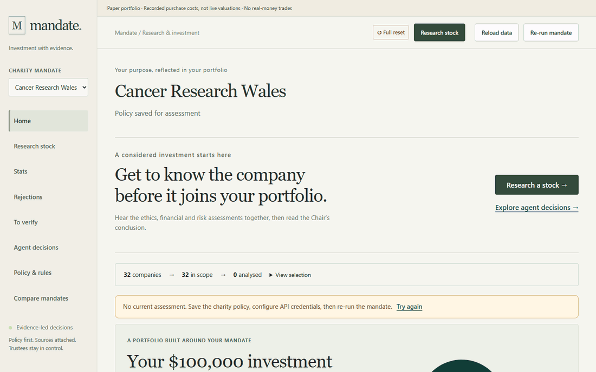

<sub>The four starred demo scenarios: no API keys needed. Each company gets three specialist views, a Chair decision and a devil's advocate, and approved ones can be bought with paper cash.</sub>

</div>

<br>

> [!NOTE]
> **Educational hackathon project. Not financial advice.** Allocations are paper transactions, never brokerage orders.

## Why Mandate

Charity trustees are usually volunteers. Their investment policy says things like *“no tobacco”* or *“consistent with our humanitarian principles”*, and someone has to turn those words into actual holdings and defend every choice. Mandate gives them an investment committee that **shows its working**:

<table>
<tr>
<td width="33%" valign="top">

**📜 Policy first**<br>
<sub>The charity's own published policy is compiled into numbered rules, each quoting its clause. Vague wording, assumed limits and open questions are surfaced, not hidden.</sub>

</td>
<td width="33%" valign="top">

**🧑‍⚖️ Three specialists, one Chair**<br>
<sub><b>Melchior</b> checks ethics rule by rule, <b>Balthasar</b> judges financial health, and <b>Casper</b> weighs risk. The <b>Chair</b> decides full, reduced or reject, but only for companies that are already ethically clean.</sub>

</td>
<td width="33%" valign="top">

**🔍 Every claim verified**<br>
<sub>Agents only read evidence our code fetched. Quotes must match stored text verbatim, metrics must be within 2%, and source IDs must resolve. Anything unverified is flagged, never trusted.</sub>

</td>
</tr>
<tr>
<td valign="top">

**⛔ A veto no model can override**<br>
<sub>A verified ethics FAIL rejects the company in code. FLAGs, missing evidence and unverified approvals go to trustee review.</sub>

</td>
<td valign="top">

**📐 Numbers from code, not LLMs**<br>
<sub>A min-volatility optimiser allocates exact dollars and whole shares under position caps and a bond floor. Any constraint it had to relax stays visible.</sub>

</td>
<td valign="top">

**😈 A devil's advocate built in**<br>
<sub>Every recommendation comes with the strongest specific objections a critical trustee would raise, plus a plain-English memo for the board.</sub>

</td>
</tr>
</table>

## How it works

<div align="center">
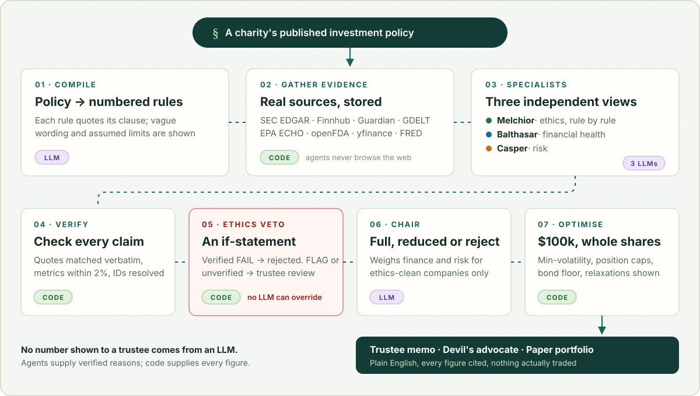
</div>

<details>
<summary><b>Who does what</b></summary>

<br>

| Role | Kind | Default model | Job |
|---|---|---|---|
| **Compiler** | LLM | `MODEL_CHAIR` | Policy text → numbered rules, proposed mission conflicts, assumed limits, trustee questions and weights |
| **Melchior** | LLM | `MODEL_MELCHIOR` | Ethics: one PASS / FAIL / FLAG verdict per rule, each with a verbatim quote and source ID |
| **Balthasar** | LLM | `MODEL_BALTHASAR` (`mai-thinking-1`) | Financial health, scored only from fundamentals, citing each metric's value |
| **Casper** | LLM | `MODEL_CASPER` (Claude, or Azure) | Risk: interprets risk statistics computed in code and legal or regulatory evidence |
| **Verifier** | Code | — | Checks quotes, metric values (within 2%) and source IDs for every claim |
| **Decision gate** | Code | — | Verified FAIL → reject. FLAG or unverified → trustee review. Otherwise passes to the Chair |
| **Chair** | LLM | `MODEL_CHAIR` | Full, reduced or reject for clean companies, weighing finance and risk by the policy's weights. Never sees a number it could allocate |
| **Optimiser** | Code | — | Min-volatility weights, whole shares, caps, bond floor, relaxation chain and a historical backtest |
| **Memo & devil's advocate** | LLM | `MODEL_CHAIR` | Plain-English trustee memo and specific counterarguments, using only numbers from the portfolio JSON |

</details>

<details>
<summary><b>Where the evidence comes from</b></summary>

<br>

The app's agents **never browse the web**. They only read evidence that the data code fetched and stored with a source ID, so every quote can be checked against stored text.

| Source | Used for |
|---|---|
| **SEC EDGAR** (10-K, 20-F, 8-K, XBRL) | Filings, legal proceedings and fundamentals |
| **Finnhub** · **Guardian** · **GDELT** | Company news |
| **EPA ECHO** · **openFDA** | Regulatory enforcement records |
| **yfinance** · **Twelve Data** · **FRED** | Prices and dividends, GBP conversion and macro series |

Committed files in `data/processed/` hold observed data, with IDs and provenance preserved by the evidence adapter.

</details>

## A tour of the app

<table>
<tr>
<td width="50%">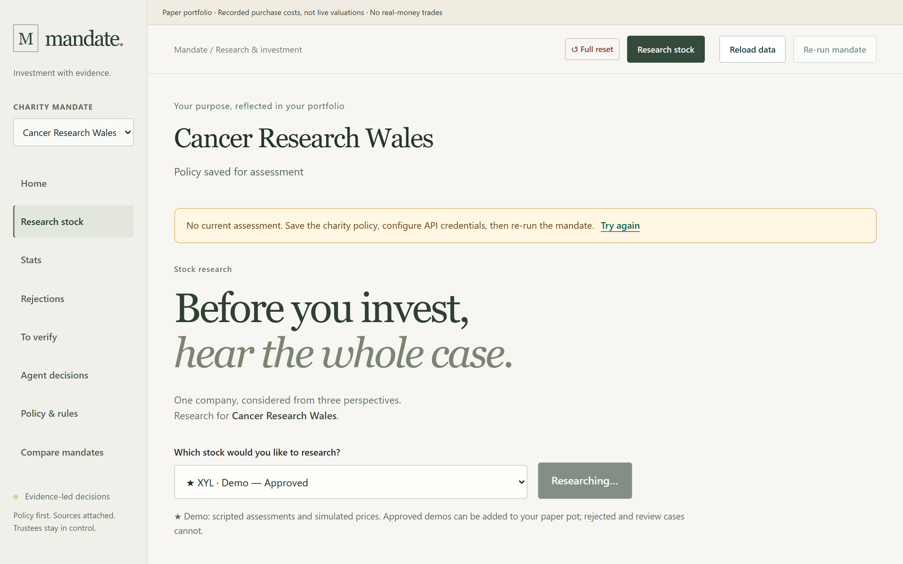<br><sub><b>Pick a company to research.</b> One company, considered from three perspectives, for the charity selected in the sidebar.</sub></td>
<td width="50%">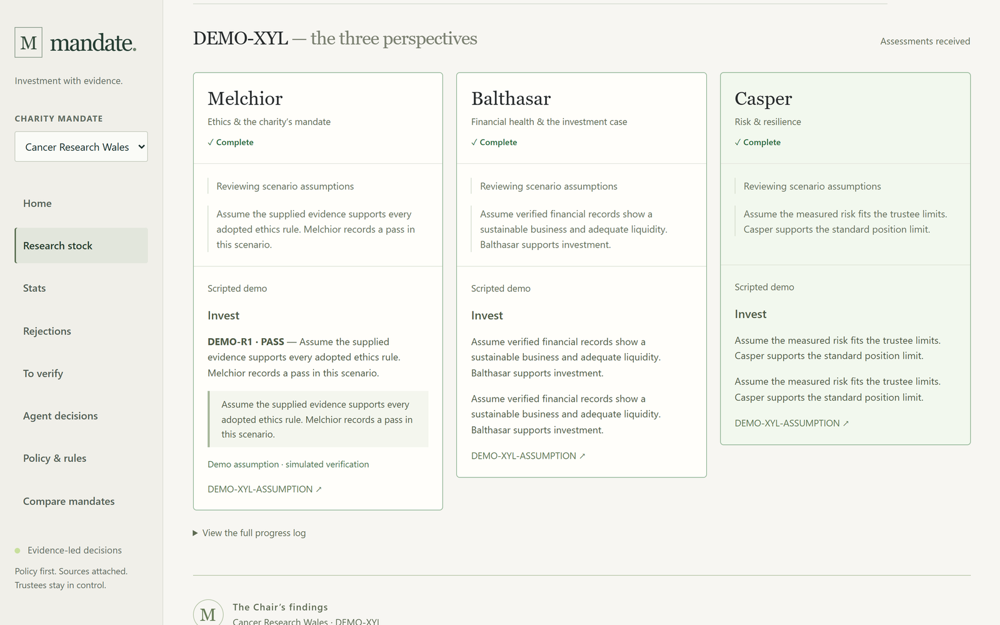<br><sub><b>The three perspectives.</b> Melchior, Balthasar and Casper each give a verdict with the evidence behind it.</sub></td>
</tr>
<tr>
<td>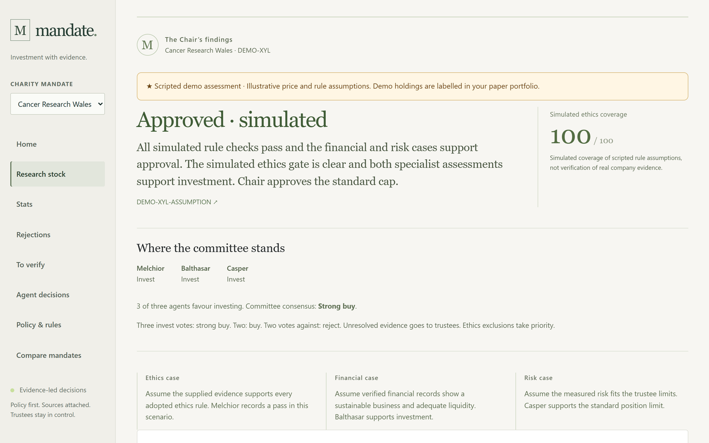<br><sub><b>The Chair's findings.</b> A decision, a coverage score calculated by code, and where each committee member stands.</sub></td>
<td>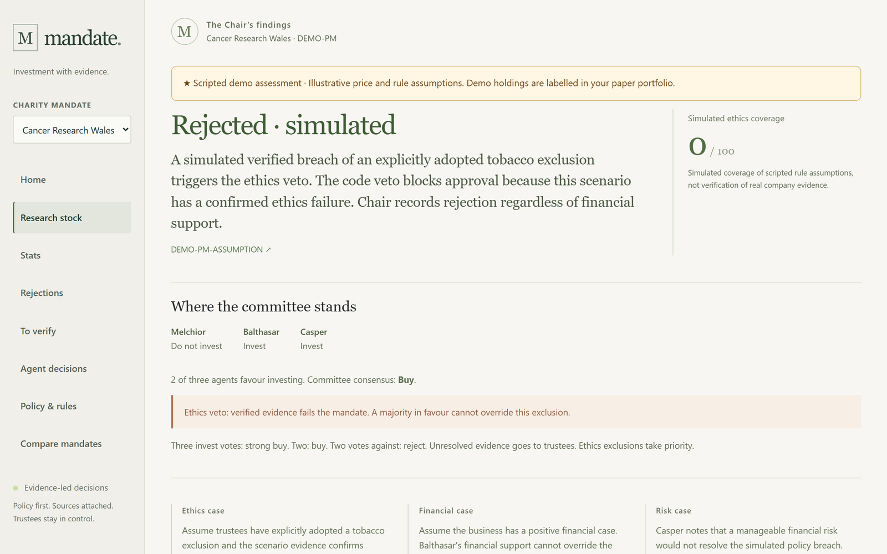<br><sub><b>The ethics veto.</b> A verified tobacco breach rejects the company, and a majority vote in favour cannot override it.</sub></td>
</tr>
<tr>
<td>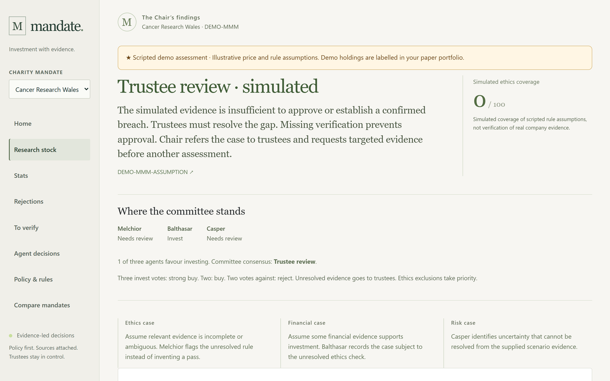<br><sub><b>Trustee review.</b> When the evidence is incomplete, the Chair refers the case to trustees instead of inventing a pass.</sub></td>
<td>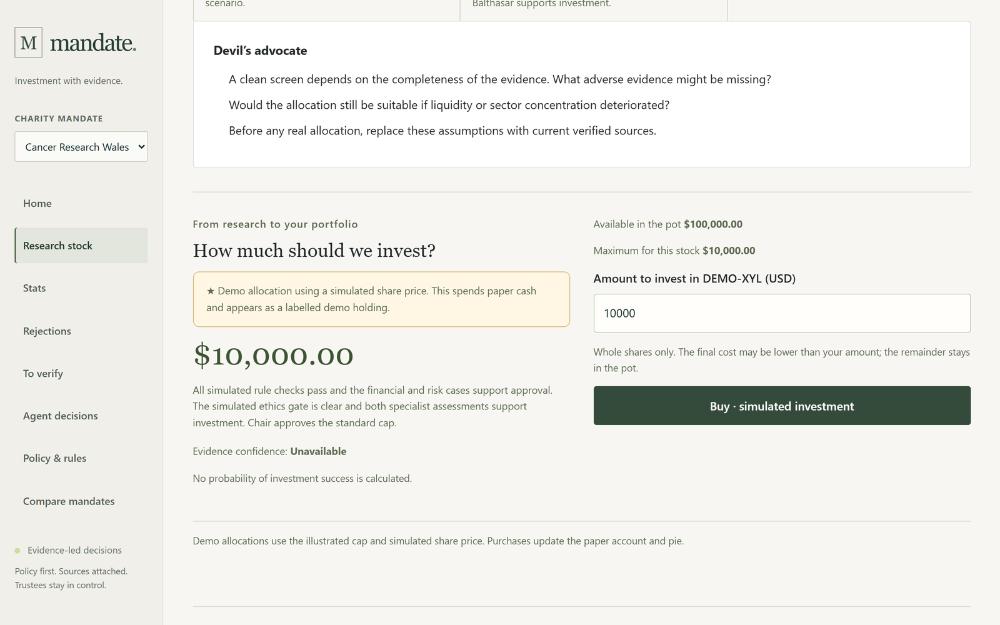<br><sub><b>Challenge, then allocate.</b> The devil's advocate pushes back, then approved companies can take paper cash in whole shares, up to their cap.</sub></td>
</tr>
<tr>
<td>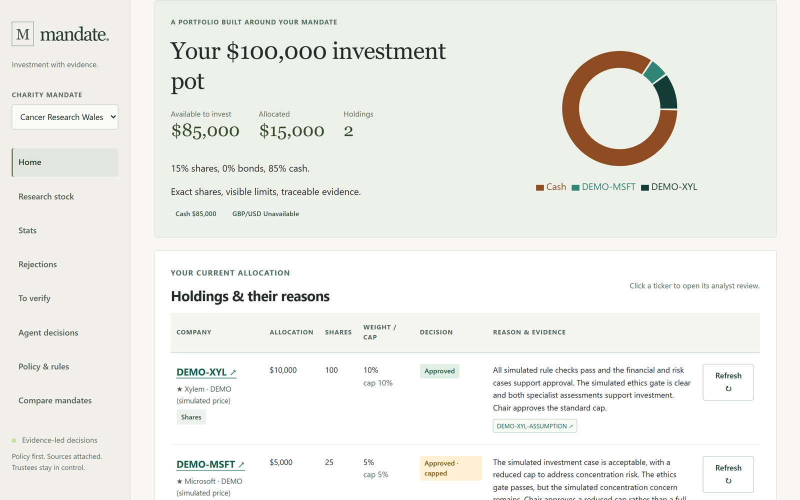<br><sub><b>The $100,000 pot.</b> Cash, allocations and holdings, each with its reason and evidence.</sub></td>
<td>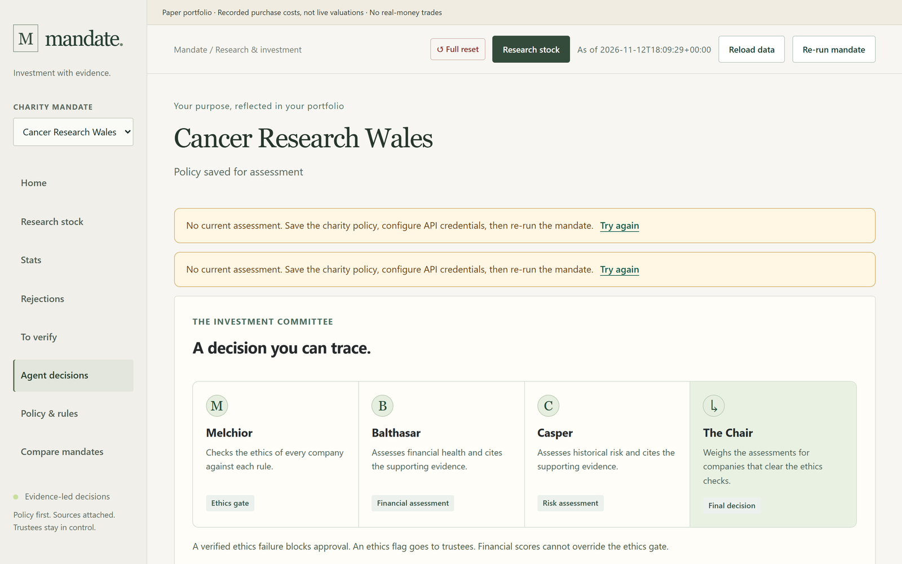<br><sub><b>A decision you can trace.</b> How the committee is organised and what each member can and cannot decide.</sub></td>
</tr>
</table>

## The demo scenarios

The research picker includes four **starred, scripted walkthroughs** that make no model calls and need no API keys, so you can see the whole flow straight after cloning:

| Scenario | Melchior | Balthasar | Casper | Chair |
|---|:-:|:-:|:-:|---|
| ★ **XYL** · Xylem | ✅ | ✅ | ✅ | **Approved**, 10% cap |
| ★ **MSFT** · Microsoft | ✅ | ✅ | ⚠️ concentration | **Approved with a cap**, 5% |
| ★ **PM** · Philip Morris | ❌ tobacco | ✅ | ✅ | **Rejected** by the code veto |
| ★ **MMM** · 3M | ❓ incomplete | ✅ | ❓ | **Trustee review** |

<sub>Company names are illustrative. Scenario assumptions and outcomes are simulated and independent of the selected charity's actual policy or current research. They never overwrite live issuer assessments.</sub>

Approved and capped scenarios can allocate from the paper pot at explicitly simulated prices, and their `DEMO-*` holdings appear in the allocation table and pie. Rejected and review cases stay blocked. Policy edits invalidate demo approvals just like live assessments.

**Built-in charities.** The supplied policies in `policies/` are real published excerpts with source provenance:

| Charity | Policy in brief |
|---|---|
| **Cancer Research Wales** | Lead story. The supplied excerpts contain no published tobacco-exclusion clause, and trustees can add one explicitly |
| **British Thoracic Society** | No tobacco, fracking or arms trade, with a lung-health mission |
| **British Red Cross** | Humanitarian, guided by the Fundamental Principles, including neutrality |
| **Nuffield Oxford Hospitals Fund** | No published ethics policy, so rules are proposed from its charitable purpose |

## Quickstart

> **Prerequisites:** Python 3.11 or 3.12 · Node.js 20+

```powershell
python -m venv .venv
.venv\Scripts\python -m pip install -r requirements.txt
Copy-Item .env.example .env
npm --prefix frontend ci
npm --prefix frontend run build
.venv\Scripts\python api.py
```

Open **http://127.0.0.1:5000** and pick a ★ demo scenario under **Research stock**. On macOS or Linux, use `.venv/bin/python` and `cp .env.example .env`. For frontend development, run `npm --prefix frontend run dev` alongside Flask.

> [!WARNING]
> Waitress binds to loopback only. This is a local, single-process workspace without user authentication, so do not expose it to the public internet.

<details>
<summary><b>Configure live research (API keys)</b></summary>

<br>

Fill in `.env` with your own credentials. It is ignored by Git. Restart the server after any change.

| Setting | Purpose |
|---|---|
| `AZURE_OPENAI_ENDPOINT`, `AZURE_OPENAI_API_KEY`, `AZURE_OPENAI_API_VERSION` | Azure OpenAI client |
| `MODEL_CHAIR`, `MODEL_MELCHIOR` | Azure deployments for the Chair and Melchior |
| `MODEL_BALTHASAR` | `mai-thinking-1` |
| `MODEL_CASPER`, `ANTHROPIC_API_KEY` | A `claude-*` model uses Anthropic; anything else uses Azure |
| `FINNHUB_API_KEY` | News |
| `SEC_USER_AGENT` | SEC EDGAR requires a real contact: `"<app or org> <contact email>"` |
| `TWELVE_DATA_API_KEY` | GBP conversion |
| `GUARDIAN_API_KEY`, `FRED_API_KEY` | Optional collectors under `ingest/` |

Prices use yfinance. `DEPLOY_*` aliases remain supported. `/api/health` reports the names of missing settings, never their values.

</details>

<details>
<summary><b>Portable keyless demo (replay real runs offline)</b></summary>

<br>

A fresh clone doesn't include ignored caches or completed assessments. Before presenting, complete the charity runs you want online with credentials, then package them:

```powershell
.venv\Scripts\python scripts/package_demo.py
.venv\Scripts\python scripts/check_demo_bundle.py results/mandate-keyless-demo.zip
```

The ZIP contains observed evidence, market and LLM caches, checksums, model metadata, and completed assessments that match the supplied published policies. Credentials, logs, custom policy edits and transaction ledgers are excluded. Paper accounts in the bundle start with the standard cash balance.

On the presentation machine, install dependencies and build the frontend while online, extract the ZIP into the repository root, then run:

```powershell
$env:DEMO_MODE='1'
.venv\Scripts\python api.py
```

- **What works offline:** no API keys or deployment settings are needed. Offline reruns replay the saved result that matches the policy, without recomputing the optimiser or calling a model. Research refresh shows the saved company assessment and explains that no fresh evidence was fetched.
- **What needs another online run:** new policies, uncached charities and new evidence.
- **Dates:** historical dates are retained, so stale real market quotes still block allocations.
- **How the bundle is checked:** the verifier tests a clean source copy with credentials removed and socket access blocked, covering portfolio replay, reports, accounts, React and file checksums.

</details>

## Using it

1. **Choose a charity** and review its supplied policy excerpts on **Policy & rules**. Saving a policy immediately invalidates its previous assessment. If credentials are missing, the document still saves and the job explains what is needed.
2. **Re-run the mandate** or **research a stock** to start a real analysis. Jobs can take several minutes.
3. **Read the decisions.** Check **Rejections**, **To verify** and **Agent decisions**, then use **Compare mandates** to see how one company fares under different charities' policies.
4. **Allocate paper cash.** Each account starts with an explicitly simulated **$100,000**. Buy requests enforce whole shares, available cash, position caps and the current policy revision. Retrying a request ID cannot allocate twice, and a quote must have an observed price no more than seven calendar days old.
5. **Watch for policy drift.** Existing positions stay visible and are flagged when the policy changes. Holdings are recorded purchase costs, not live valuations. **Stats** shows the optimiser's suggested portfolio separately from the paper ledger.
6. **Full reset** (top bar, asks to confirm) returns every charity to its supplied policy and a fresh cash pot. It clears saved edits, assessments, demo approvals, holdings, receipts, jobs and this browser's Mandate storage. Background jobs started before the reset can't restore old state. Source data, credentials and caches are kept. Reload any other open tabs afterwards.

## Guardrails

- **No number shown to a trustee comes from an LLM.** Numbers come from data or code.
- **An LLM can never approve a company with a verified ethics FAIL.** This is an `if` in code. Missing evidence, failed Chair calls and unverified approvals require trustee review.
- **The specialist score is code-calculated verified-claim coverage**, not an LLM rating or a probability of success. Verification checks cited quotations and metric values, not the truth of every natural-language inference.
- **Proposed mission restrictions are not adopted automatically.** Trustees may add restrictions explicitly on the Policy page.
- **No fake data.** There is no fake data server or synthetic fallback, and missing measurements are null or explicit errors. `DEMO_MODE=1` permits cache reads only, including LLM calls.
- **Honest scope.** The active research universe is the 32 equities listed in `mandate/universe.py` plus four bond ETFs (SHY, IEF, BND, TIP). The UI reports actual counts and does not claim the planned 550-to-40 screening funnel ran. Bond ETFs skip company ethics checks, and their decisions are labelled accordingly.
- **Visible compromises.** Optimiser constraint relaxations stay visible. The portfolio's devil's advocate covers evidence gaps, bond-screening exemptions, assumed limits, relaxations, concentration and any historical benchmark shortfall.

## Verify

```powershell
npm --prefix frontend run build
npm --prefix frontend test
.venv\Scripts\python -m unittest tests.test_integration quant.test_stats quant.test_portfolio -v
```

There are **31** Python tests and **13** frontend tests, and the same steps are defined as a GitHub Actions workflow in [`.github/workflows/build.yml`](.github/workflows/build.yml). They use temporary accounts and controlled doubles only inside the test suite, covering:
- policy persistence and stale revisions
- idempotent paper transactions
- missing data and source resolution
- ethics vetoes and cache-only mode
- portfolio maths
- React policy saving and Flask asset serving

Test recommendations are never loaded by the application. Live checks require valid credentials and provider access; offline tests alone do not establish that external services are available.

## Project layout

<details>
<summary><b>Repository structure</b></summary>

<br>

```text
Mandate/
├── api.py               Flask + Waitress entry point (serves the built React app and JSON API)
├── mandate/
│   ├── agents/          compiler, melchior, balthasar, casper, chair, memo, devils_advocate
│   ├── verify.py        quote, metric and source-ID checks for every agent claim
│   ├── decide.py        ethics veto, FLAG handling and caps, in plain code
│   ├── optimise.py      min-volatility optimiser, whole shares, relaxation chain, backtest
│   ├── pipeline.py      run_charity(): the seven-stage run, every call cached on disk
│   ├── web.py           adapts internal models to the React API contract
│   └── demo_scenarios.json   the four starred walkthroughs
├── ingest/              EDGAR, Finnhub, Guardian, GDELT, EPA, FDA, prices, FX, FRED collectors
├── quant/               shared risk statistics and integer share-allocation repair
├── policies/            published charity policy excerpts with source provenance
├── data/processed/      committed observed data the API reads
├── frontend/            React 19 + Vite + TypeScript + Tailwind v4 + Recharts
├── scripts/             data fetch, demo packaging and bundle verification
└── tests/               integration tests
```

Raw responses and model caches live in `cache/` and `data/cache/`. Accounts, saved policy revisions and completed assessments live in `results/workspace/`. These folders are ignored by Git. Jobs are process-local, so restart an interrupted job after a server restart; completed accounts and assessments remain on disk.

</details>

## About the project

Built by a three-person team for the **Microsoft × LSEG Hackathon 2026**: one person on data ingestion and evidence, one on the agents, verifier and API, and one on the quant engine and React frontend. The working contract the team built against is in [CLAUDE.md](CLAUDE.md).

<br>

<div align="center">
<sub><b>Educational hackathon project. Not financial advice.</b> Paper transactions only, never brokerage orders.</sub>
</div>
